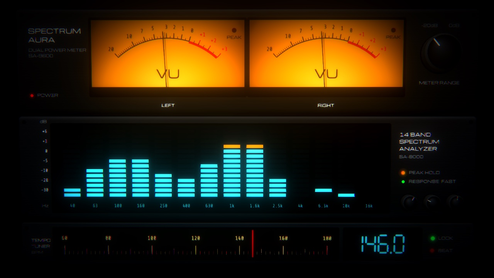
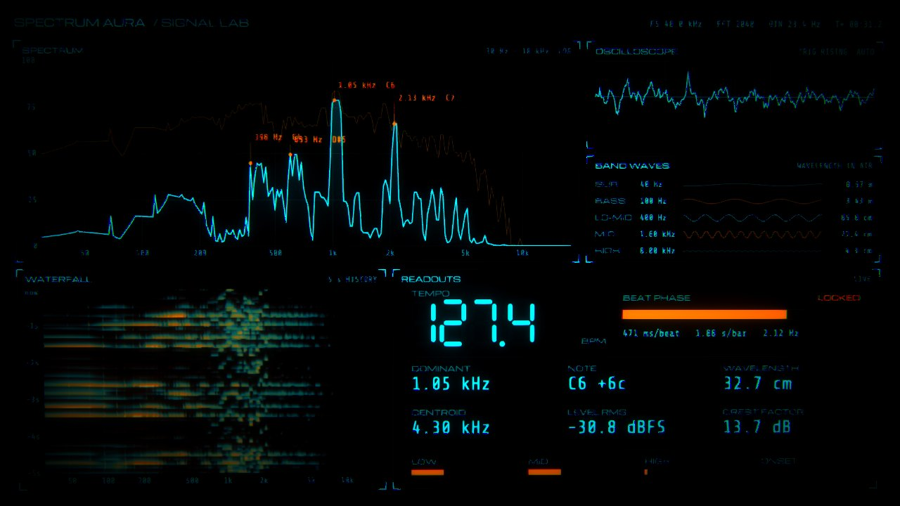
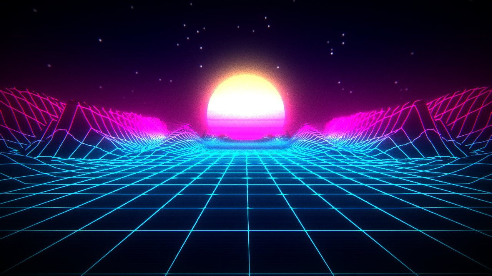

# Spectrum Aura Development Guide

This guide covers the architecture, key concepts, and development workflows for Spectrum Aura.

## Project Structure

```
src/
├── App.tsx
├── main.tsx
├── components/
│   └── analyser/
│       ├── Analyser.tsx              # Thin orchestrator (overlays + hook wiring)
│       ├── BarTimingHud.tsx          # BPM / bar grid overlay (M toggle)
│       ├── TempoReadout.tsx          # Shared BPM + grid (overlay + panel)
│       ├── theme.ts                  # Colors, swatches, bpmGlowStyle, LOCAL_DEV_URL
│       ├── ControlPanel.tsx          # Settings panel and its sections
│       ├── control-panel/
│       │   ├── primitives.tsx        # Sw, Bn, Row, ToggleRow, S
│       │   └── ViewSettings.tsx      # Per-view slider/toggle blocks (14 views)
│       ├── hooks/
│       │   ├── useAnalyserEngine.ts  # rAF/XR loop, audio, SongClock, scene
│       │   ├── useBeatHintBridge.ts  # T / ⇧T manual sync bridge
│       │   ├── useAnalyserCommandEvents.ts
│       │   └── usePresetActions.ts   # Shared preset load/save/cursor
│       ├── overlays/
│       │   ├── AudioSourcePrompt.tsx
│       │   ├── FreqLabels.tsx
│       │   ├── LatencyHud.tsx
│       │   ├── StatsPanel.tsx
│       │   └── stats-types.ts
│       ├── Shortcuts.tsx
│       ├── store.ts
│       ├── visuals.ts
│       ├── visuals/                  # Optional *.visual.ts manifests
│       ├── __tests__/                # Component + store + UI tests
│       │   ├── helpers/test-helpers.ts
│       │   ├── Analyser.regression.test.ts
│       │   ├── ControlPanel.regression.test.ts
│       │   ├── usePresetActions.test.ts
│       │   ├── theme.test.ts
│       │   ├── Shortcuts.test.tsx
│       │   └── store.*.test.ts
│       └── engine/
│           ├── audio.ts              # FFT read, BeatMatcher, BPMDetector feed
│           ├── beat-matcher.ts         # Multi-band onset detection
│           ├── bpm-detector.ts       # Tempo estimation (not grid owner)
│           ├── song-clock.ts         # Authoritative bar/beat clock
│           ├── bar-clock.ts          # BarTiming types + SongClock re-export
│           ├── live-tempo.ts         # Per-frame HUD bus
│           ├── latency-metrics.ts    # Render latency measurement (tested)
│           ├── view-cycle-controller.ts
│           ├── loudness.ts           # Shared perceptual-loudness gamma curve (all views)
│           ├── evolution.ts          # Dynamic Mode drift engine
│           ├── scene.ts
│           ├── composer.ts           # Post-FX chain + auto quality tiers
│           ├── shaders.ts
│           └── __tests__/            # Engine unit + sync invariant tests
│               ├── helpers/song-clock.harness.ts
│               ├── song-clock.test.ts
│               ├── sync-invariants.test.ts
│               └── …
│   └── ui/                           # label, slider, switch only
AGENTS.md                             # Agent guide (Cursor / Claude)
docs/
├── README.md                         # Documentation index
├── audio-analysis-pipeline.md
├── song-clock-and-sync.md
├── rendering-and-latency.md
├── fft-and-beat-detection.md         # Short overview (links to above)
└── screenshots/
```

## Architecture Overview

### Audio and Sync Pipeline

1. **Capture** (`engine/audio.ts`) — mic or tab → `AnalyserNode` (default FFT 2048)
2. **Features** — bass / mid / high / centroid each frame
3. **BeatMatcher** — fused onset detection for accents and signal-change timing
4. **BPMDetector** — tempo estimate + confidence (feeds SongClock, does not own grid after manual tap)
5. **SongClock** (`engine/song-clock.ts`) — authoritative bar grid, `beatPhase`, phrase boundaries
6. **Consumers** — `scene.ts`, post-FX, `BarTimingHud`, `view-cycle-controller`

Deep dive: [audio-analysis-pipeline.md](./audio-analysis-pipeline.md), [song-clock-and-sync.md](./song-clock-and-sync.md), [rendering-and-latency.md](./rendering-and-latency.md).

### MIDI control and external sync

The user guide is [MIDI input and Ableton Live](midi.md). Keep MIDI input
independent of audio capture so controllers can perform with or without sound.

- `packages/engine/src/midi.ts` owns Web MIDI input lifecycle and note/CC parsing.
- `packages/engine/src/midi-mapping.ts` defines destinations, ranges and pick-up.
- `packages/engine/src/midi-clock.ts` decodes external pulses and transport.
  SongClock derives the authoritative beat/bar grid from that input.
- `src/components/analyser/hooks/useMidiControl.ts` applies actions to the app.
- `src/components/analyser/midi-store.ts` persists controller configuration
  separately from visual presets. `control-panel/MidiPanel.tsx` provides Learn,
  device selection, live input monitoring and clock selection.

Select one external clock port; never combine clocks from multiple devices.
External sync blocks audio BPM takeover, freezes on Stop or clock loss, and
returns to manual control through T/Shift+T. Preserve those rules when changing
sync. Run `midi.test.ts`, `midi-mapping.test.ts`, `midi-clock.test.ts`,
`midi-store.test.ts`, `useMidiControl.test.tsx`, `song-clock.test.ts` and
`sync-invariants.test.ts` for MIDI changes. Simulated tests do not establish
physical-device compatibility; outstanding checks live in the
[MIDI controller plan](plans/midi-controller-support.plan.md).

### Visualization Architecture

**Three.js Scene** (`engine/scene.ts`):

- **30 visualization modes**: combo, classic, ripple, datastream, nebula, monolith, mandala, terrain, obsidian, torus, soundwall, geometrynebula, reztube (On-rails Tube), assetflow, wikichroma, stagelights, outrun, globe, spectrotunnel, fractal, blackhole, neoncity, ocean, nightwood, desert, station, aurora, hifi, tapedeck, lab
- **Lazy views** (`engine/views/`): outrun, globe, spectrotunnel, fractal, blackhole, neoncity, ocean, nightwood, desert, station, aurora, hifi, tapedeck and lab implement `LazyView` and are registered in `LAZY_VIEW_FACTORIES` in `scene.ts`. They are constructed on first activation and disposed after `LAZY_VIEW_IDLE_DISPOSE_SECONDS` off-screen. Prefer this for new views: `scene.ts` gains a registry entry and an empty `<id>Group` holder instead of build/update/dispose code

  | Hi-Fi                                                                                     | Signal Lab                                                                                   | Outrun                                                                  |
  | ----------------------------------------------------------------------------------------- | -------------------------------------------------------------------------------------------- | ----------------------------------------------------------------------- |
  |  |  |  |

  Hi-Fi, Tape Deck and Signal Lab draw with the 2D canvas API into one texture (`views/instrument-panel.ts`), which is the pattern to copy for any view that is mostly lettering and dials. Controls that should stand proud of the panel in 3D are added with `InstrumentPanel.raiseDisc` / `raiseBox`: the face of each is cut from the panel texture, so the drawing stays the single source of what a knob or key looks like.

- **Bundled presets** (`src/components/analyser/default-saves.json`): the presets a new visitor starts with. Each entry names a thumbnail under `public/assets/default-looks/`; a test fails if the file is missing. Add `"since": <DEFAULT_SAVES_VERSION>` to a new entry and bump `DEFAULT_SAVES_VERSION` in `store.ts`, so people with an existing saved list receive it once. Regenerate thumbnails and `docs/screenshots/scene-*.jpg` with `npm run capture:presets -- track.wav` while the dev server runs (see `scripts/capture-presets.mjs`).
- **Scene backdrop** (`views/backdrop.ts`): one full-screen shader drawn before everything else, giving the original views a starfield, grid floor or data rain. It rebuilds each pixel's view ray from the camera, so it stays fixed in the world as the camera moves. `VIEW_BACKDROPS` maps each view to its world; lazy views draw their own and get none.
- **InstancedMesh**: Used for efficient bar/block rendering (bars, classic, monolith)
- **ShaderMaterial**: Custom shaders for effects (datastream, nebula, terrain)
- **Post-processing**: Bloom, chromatic aberration, glitch, god rays, lens flare, etc. via Composer
- **Fat lines**: `Line2`/`LineGeometry`/`LineMaterial` (mandala ribbons) and `LineSegments2`/`LineSegmentsGeometry`/`LineMaterial` (On-rails Tube) from `three/examples/jsm/lines/` for screen-space pixel-width lines that respect `linewidth` in WebGL

**Each View Has**:

- `buildXXX(size)`: Initialize geometry/materials
- `updateXXX(dt, audio, opts)`: Per-frame animation driven by audio + settings

### Settings & State (`store.ts`)

- **Settings**: 40+ properties controlling every aspect
- **Presets**: built-in curated looks plus a dynamic local save list
- **Normalization**: Enforces limits on amplitude, vignette, bloom
- **Randomization**: Smart background picker using WCAG contrast scoring

Recent controls:

- `postFxEnabled`: Master switch that bypasses the post-processing pipeline at render time.
- Global Wireframe control in the View panel: writes to the active view-specific wireframe setting.
- `randomizeViewSettings`: Keeps randomize constrained to post FX by default; when enabled it also touches view-specific geometry and palette controls.
- `lensFlare` / `lensFlareAmount`: Anamorphic horizontal streak + coloured lens-ghost reflections layered after god rays in the composer chain. Enabled 45% of the time by randomize.
- `monolithBrightness`: Dedicated lighting/visibility control for Monolith independent of amplitude.
- `reztubeLineWidth`: Line thickness in screen-space pixels for the On-rails Tube view (0.5–6 px). Rendered via `LineSegments2` + `LineMaterial` (`worldUnits: false`) so the width is invariant to camera distance. The visual's display label was updated to "On-rails Tube"; the internal `id` stays `reztube` to preserve saved settings.
- `assetflowMovement`: Global motion intensity multiplier for Asset-Flow model pathing, bounce, and spin.
- `assetflowBackgroundDrift`: Speed/intensity control for Asset-Flow's layered 2D background drift.
- `assetflowSpriteAmount`: Controls layered 2D background presence/intensity in Asset-Flow.
- Asset-Flow actor motion is intentionally biased toward vertical movement with smoothed horizontal follow to prevent visual left/right flicker.
- **Stage Lights** view: a row of overhead spotlight beams (LOW/MID/HIGH-aligned by position, `stagelightsFixtureCount` 3/5/7) sweeping and fanning out on strong beats, plus an optional `stagelightsLasers` fan of thin upward beams from a downstage projector. Per-fixture tuning (sweep speed/phase/amplitude/width/color) is a continuous blend across the LOW/MID/HIGH anchors by each fixture's position (`stagelightsTent3` in `scene.ts`) rather than a fixed 3-way lookup, so extra fixtures land _between_ bands instead of repeating them.
- `kaleidoscope` / `kaleidoscopeSides` / `kaleidoscopeAngle`: mirrored radial wedge post-FX pass.
- `mirrorFx` / `mirrorMode` / `mirrorOffset`: directional mirror post-FX pass.
- `crtFx` / `crtScanlineIntensity` / `crtCurvature` / `crtVignette`: retro CRT post-FX pass.
- `projectorFilmFx` / `projectorFilmAmount` / `projectorFilmJitter` / `projectorFilmFlicker`: random film projector artifact pass.
- `glitchIntensity`: duty-cycle fraction (0-1) of each ~1 s window the Glitch pass actually renders — three.js's GlitchPass has no continuous intensity knob.
- `evolveEnabled` / `evolveAmount`: "Dynamic Mode" — a curated 1-3 settings per view drift slowly over musical phrases (wall-clock fallback when unsynced), bounded around the user's own values (`engine/evolution.ts`).
- ControlPanel: a **Presets** section (thumbnail grid; load, replace and delete via `usePresetActions`), the Dynamic Mode toggle, an amber warning banner in Effects when Performance Mode is bypassing the pipeline, and retro/novelty effects grouped under a collapsed `Disclosure`. See "Settings panel" below for the layout.

**Key Settings Limits**:

- Amplitude floor: 0.5 (MIN_VIEW_AMPLITUDE)
- Vignette amount: [0.5, 1.25]
- Bloom strength: ≤ 0.25 (unless bloomExtreme)
- Asset-Flow movement intensity: [0.35, 1.8]
- Stage Lights sweep speed: [0.2, 3]; fixture count snaps to 3/5/7

## Shortcut Map

Shortcuts are defined once, in `src/components/analyser/keymap.ts` (`KEY_BINDINGS`). The key handler in `Shortcuts.tsx`, the cheat sheet (`CheatSheet.tsx`, `?`), the command palette (`CommandPalette.tsx`, `/` or `⌘K`) and the toolbar's key caps all read that table. To add or change a key, edit the table: a key bound twice throws at load, and `keymap.test.ts` covers naming and the legacy aliases.

- `←` / `→` previous / next view
- `↑` / `↓` previous / next preset
- `Space` play or pause the presets
- `1`–`9` load a preset; `⇧1`–`⇧9` save over it
- `R` randomize the look; `⇧R` jump to a random preset
- `C` cycle views with the music; `D` Dynamic mode
- `−` / `+` calmer / punchier
- `T` tap the beat; `⇧T` tap bar 1
- `F` fullscreen; `H` hide or show the controls; `P` effects on or off
- `M` tempo and bar display; `L` latency display; `N` stats (`⇧N` full page)
- `/` or `⌘K` search everything; `S` settings; `I` input source; `?` show all shortcuts

Older keys still work: `B` / `V`, `[` / `]`, `⇧←` / `⇧→`, `\`, `A`, `G`, `X`, `=`.

Rules the handler follows:

- Typing in a text field never runs a shortcut. Sliders and switches keep their own keys; only `S` reaches through them.
- `Space` and `Enter` are left to a focused button, and `↑` / `↓` are left to the open settings panel so it can scroll.
- Actions run through one `run(action)` switch, also reachable by dispatching `RUN_ACTION_EVENT` (`runAction()`), which is how the palette and panel buttons trigger them.

Toolbar groups: Visuals (previous, randomize, next), Presets (previous, play, next, save), Response, and More (Settings, Search, Fullscreen, Displays, Keys, Hide). Input Source shows only with no source; Beat Tap only with a source and an unlocked tempo. When hidden (`H`), a **controls · h** pill restores it.

Settings panel:

- One panel (`ControlPanel.tsx`) docked right, 460 px wide, with sections from `PANEL_TABS` in `command-items.ts`: View, Effects, Scene, Audio, Presets, MIDI. `S` reopens the last section; `TOGGLE_SETTINGS_PANEL_EVENT` with `{ tab }` opens a given one.
- The filter box hides controls whose label does not match. It works on the rendered panel through `data-ctl` attributes set by the primitives (`S`, `Row`, `ToggleRow`, `Disclosure`, `FxSection`), so new controls built from those primitives are filterable with no extra work.
- `PanelFilterContext` (`control-panel/panel-filter.ts`) carries two modes: `searching` opens collapsed sections, and `activeOnly` makes effect sections list only effects that are on. `EFFECT_ROWS` in `ControlPanel.tsx` feeds the "Add an effect" list and must gain an entry when an effect row is added.
- A slider given its setting key (`<S k="outrunSpeed" …>`) marks itself with an amber dot when off its default and resets on a click of the dot. Pass `k` on every new slider. "Reset this view" resets settings whose key starts with the view id.
- While a filter is typed every section except MIDI renders, so the filter spans the panel. Section roots carry `data-section`; anything in them that is not a labelled control is hidden unless it holds a match.
- New presets are named by `presetName` (`preset-name.ts`): the view label, plus the first effect switched on beyond the defaults, numbered only on a clash. Saving over a preset keeps its name and nothing is renumbered on delete.
- `ViewControls` wraps `ViewSettings` and shows each view's first four controls, with the rest under "More controls". Order a view's controls by how much they change the picture.

## Common Tasks

### Adding a New Visualization Mode

1. Add a visual manifest to `packages/engine/src/visuals.ts` or a new `src/components/analyser/visuals/*.visual.ts` file.
2. Create `buildXXX()` and `updateXXX()` in `scene.ts` and bind the manifest `sceneGroupKey` to the owning `THREE.Group`.
3. Add settings in `store.ts` for customization, including the `...Fullscreen` or `...Wireframe` keys referenced by the manifest when needed.
4. Add per-view controls in `control-panel/ViewSettings.tsx`. Shell layout and flyout tabs stay in `ControlPanel.tsx`. View labels, cycle order, and fullscreen wiring come from the visual registry automatically.
5. Verify the shortcut rail still reads correctly: current label, `3D/2D` state, and visual cycling all depend on the registry metadata.

Runtime registry notes:

- `packages/engine/src/visuals.ts` is the canonical visual registry used by the control panel, shortcuts, and XR view cycle.
- Any `src/components/analyser/visuals/*.visual.ts` module exporting `visual` or a default object with an `id` is loaded at startup via `import.meta.glob(..., { eager: true })`.
- Runtime manifests can override labels, settings labels, fullscreen keys, wireframe keys, scene group keys, and order without re-editing the UI lists.
- Rendering logic still lives in `scene.ts`, so new runtime-picked visuals need a matching scene group and update branch before they can draw.
- Review rule: if a visual manifest changes label/order/fullscreen metadata, check `Shortcuts.tsx`, XR cycle behavior, and the View section in `ControlPanel.tsx` together.

### Adding a lazy view (preferred for new scenes)

A lazy view is one class in `packages/engine/src/views/` implementing
`LazyView` (`group`, `update(frame)`, `dispose()`). Registering it touches a
fixed list of places; the tests named below fail if one is missed.

1. `visuals.ts`: a manifest with `id`, `label`, `sceneGroupKey`, `order` and, if the view has a 2D mode, `fullscreenKey` (`visuals.test.ts` pins the order).
2. `settings.ts`: the view's keys in `Settings` and `DEFAULT_SETTINGS`.
3. `scene-update-opts.ts`: the same keys in the type, the initial object and `syncSceneUpdateOpts`.
4. `scene.ts`: an entry in `LAZY_VIEW_FACTORIES` and a `<id>Group` holder (`lazy-views.test.ts` lists the ids).
5. `evolution.ts`: which keys Dynamic mode may drift.
6. `store.ts`: the amplitude clamp and the randomize ranges.
7. `control-panel/ViewSettings.tsx`: controls built from `<S k=…>` / `<Sw k=…>`, most useful first (`ControlPanel.regression.test.ts` lists the keys).
8. `default-saves.json`: a bundled preset with a thumbnail and `since` (see Bundled presets above).

Views that meter the spectrum should read levels through `meterLevel`
(`views/types.ts`), which starts from the analyser's noise floor, so a quiet
room looks quiet. `bandPeak`, `waveLevels`, `NeedleBallistics` and the other
instrument helpers in `views/instrument-math.ts` are pure and unit-tested.

Stereo meters read `audio.stereo` when it is present and fall back to
`audio.wave` (mono), then to the spectrum for synthetic sources that have no
waveform. See `hifi-view.ts` (`channelVu`) and `tapedeck-view.ts`
(`readLevels`).

### Modifying Audio Features

1. Edit feature extraction in `engine/audio.ts`
2. Update `AudioBands` type if adding new properties
3. Connect to visualization in `scene.ts` update methods
4. Expose via settings in `store.ts` if user-tunable

### Adding UI Controls

1. Create slider in `control-panel/ViewSettings.tsx` or a flyout tab in `ControlPanel.tsx` using `<S>` from `control-panel/primitives`
2. Bind to store setting: `set({ settingName: value })`
3. Ensure setting has entry in `DEFAULT_SETTINGS` in `store.ts`
4. Test in dev mode with `npm run dev`

Notes for mapped/global controls:

- For global controls that map to view-specific settings (for example wireframe), keep UI mapping logic in `ControlPanel.tsx` and preserve underlying per-view keys in `Settings`.
- For master bypass toggles (for example post FX), apply the bypass in `hooks/useAnalyserEngine.ts` render flow so individual effect settings remain unchanged.

## Testing

### Run Tests

```bash
npm run test:run               # Single run
npm run test                   # Watch mode
```

### Test layout

All tests live under `__tests__/` (see `vitest.config.ts`):

| Location                         | Suites                                                                                                                                                                                                |
| -------------------------------- | ----------------------------------------------------------------------------------------------------------------------------------------------------------------------------------------------------- |
| `analyser/__tests__/`            | `Analyser.regression`, `ControlPanel.regression`, `usePresetActions`, `theme`, `Shortcuts`, `store.*`, `visuals`, `BarTimingHud`                                                                      |
| `packages/engine/src/__tests__/` | `song-clock`, `sync-invariants`, `bpm-detector`, `bpm-detector.realistic`, `beat-matcher`, `latency-metrics`, `view-cycle-controller`, `latency-benchmark`, `loudness`, `evolution`, `composer`, `xr` |

Shared fixtures: `__tests__/helpers/test-helpers.ts`, `engine/__tests__/helpers/song-clock.harness.ts`.

### Test coverage highlights

- **sync-invariants.test.ts** — manual anchor, misaligned audio drift guard, manual→auto release, phrase view cycle
- **Analyser.regression.test.ts** — render-loop TDZ guard (`useAnalyserEngine`)
- **ControlPanel.regression.test.ts** — ViewSettings delegation, per-view keys, theme swatches
- **usePresetActions.test.ts** — wrap/random helpers, slot cursor rules
- **song-clock.test.ts** — tap/auto modes, beat index math
- **store.\*** — normalization, slots, randomize
- **Shortcuts.test.tsx** — rail UI and keyboard behavior
- **latency-metrics.test.ts** — signal latency only on transient frames; no stale timestamp growth

Asset documentation:

- Keep `docs/THIRD_PARTY_ASSETS.md` in sync whenever adding/removing runtime files under `public/assets/`.
- Validate third-party model URLs and licenses before wiring new `model-xx.glb` paths in `scene.ts`.

### Adding Tests

1. Place new files under `src/**/__tests__/` (not beside source modules)
2. Import implementation with relative paths (`../store`, `../song-clock`, etc.)
3. Use `vi.resetModules()` and a localStorage mock for deterministic store tests
4. Test behavior through public APIs (`settingsStore`, `SongClock`, `BPMDetector`)
5. For sync changes, extend `sync-invariants.test.ts` and `song-clock.test.ts`

Example:

```typescript
it("enforces constraint X", async () => {
  const { settingsStore } = await import("./store");
  settingsStore.set({ myValue: 999 });
  const state = settingsStore.get();
  expect(state.myValue).toBeLessThanOrEqual(LIMIT);
});
```

## Build & Deploy

### Development

```bash
npm install                    # Install deps
npm run dev                    # Start Vite dev server (localhost:6789)
```

### Debug in Cursor / VS Code

Use **Run and Debug → Launch Chrome (Spectrum Aura)** (`.vscode/launch.json`). This starts Vite and opens Chrome at `http://localhost:6789` with source maps.

Do not use Cursor's Simple Browser or a LAN IP URL for audio work — `getUserMedia` / `getDisplayMedia` need a secure context (`localhost` or HTTPS).

### Production Build

```bash
npm run build                  # Builds to dist/
npm run preview               # Preview production build locally
```

### Performance Notes

- Large FFT size (4096) = better frequency resolution but higher latency
- Instanced meshes (bars/monolith) render efficiently with 1000+ objects
- Post-FX (bloom) can be expensive; tune `bloomStrength` and `bloomRadius`
- Point clouds (datastream) limited to ~30k points for 60fps on typical hardware

## Code Style

- **TypeScript**: Strict mode, full type coverage
- **React**: Functional components, hooks (useSyncExternalStore for store)
- **Three.js**: Use `THREE.` namespace prefix consistently
- **Shaders**: Documented with `/* glsl */` comment, uniform names prefixed `u`
- **Settings**: Always add to `DEFAULT_SETTINGS` and set sane limits

## Repository conventions

- Keep documentation inside `docs/` unless it is a top-level product artifact (`README.md`, `AGENTS.md`, license, tooling config).
- Keep tests in `__tests__/` folders; Vitest only includes `src/**/__tests__/**/*.{test,spec}.{ts,tsx}`.
- Agents: read [AGENTS.md](../AGENTS.md) before changing sync or render-loop code.
- Prefer concern-specific test files (`store.normalization.test.ts`, `store.slots.test.ts`) over catch-all files.
- When adding a new setting, update all required layers in one change set:
  1. `Settings` type + `DEFAULT_SETTINGS` in `store.ts`
  2. pass-through in `hooks/useAnalyserEngine.ts` and `Scene.update()` options
  3. controls in `control-panel/ViewSettings.tsx` or `ControlPanel.tsx` flyouts (if user-facing)
  4. at least one targeted test
- When changing shortcut-bar behavior, update all three together:
  1. keyboard handling + rail UI in `Shortcuts.tsx`
  2. tooltip copy / active-state affordances in the same file
  3. `Shortcuts.test.tsx` expectations

## Known Limitations

- **Mobile**: Not optimized for touch, works best on desktop
- **Audio**: Requires user gesture (click) to start, due to browser autoplay policy
- **Cross-origin**: Tab audio capture only works on same-origin (security)
- **Browsers**: WebGL 2 required (most modern browsers)

## Debugging Tips

1. **Enable stats panel**: Press `N` for live FPS/draw calls/memory
2. **Visual debug**: Add `console.log()` in `scene.update()` to inspect audio values
3. **Settings debug**: Store uses localStorage; inspect via DevTools `Application > Storage > Local Storage`
4. **Shader errors**: Check browser console for THREE.WebGLProgram validation errors
5. **Performance**: Use DevTools Performance tab, look for GPU bottleneck vs CPU

Render-loop safety note:

- In `hooks/useAnalyserEngine.ts`, initialize render-loop state variables before deriving values from them. A prior TDZ bug (`Cannot access 'displayedView' before initialization`) occurred when a composer reset key was built before `displayedView` was declared.

## Contributing

- Keep changes scoped (one feature per PR)
- Update relevant tests when adding features
- Verify build passes: `npm run build`
- All tests must pass: `npm run test:run`

## Response, saved state and HUD regression checks

See [response and balance](response-and-balance.md) for the feedback controller
and default/persistence contract. `visual-response.test.ts` verifies that gain
never modifies detector input or timing. `visual-balance.test.ts` covers sustained
brightness/activity, silence, bounds and reset. `visual-balance-monitor.test.ts`
checks readback cadence, backoff and failure handling.

`Shortcuts.test.tsx` covers response keys, limits, typing/browser-zoom exclusions,
VR hints and tooltip survival through live updates. `store.normalization.test.ts`
checks legacy defaults and a persisted Auto balance opt-out. Saved-look comparison
lives in `saved-look.ts`; use `usePresetActions` for both toolbar and settings flows.
`preset-state.test.tsx` and `store.slots.test.ts` cover action availability and
calibration preservation when loading saves.

`StatsPanel.test.tsx` covers panel layout and persistence. `stats-history.test.ts`
checks graph smoothing/ranges. Panel primitives must remain stable across live
updates so focused controls and open tooltips are not remounted.

## Testing with real audio

Band-level simulations (`sync-benchmark.test.ts`) cannot show how the pipeline
behaves on an actual signal — real kicks make levels spike on every hit, which
flat test levels hide. To test end to end, play a WAV file into the app as the
microphone:

1. Launch Chromium with
   `--use-fake-device-for-media-stream --use-fake-ui-for-media-stream --use-file-for-fake-audio-capture=/path/track.wav%noloop`.
2. Open the dev server and click **Use microphone**.
3. Read state from the dev-only `window.__debug` seam (`useAnalyserEngine.ts`):
   `audio`, `scene`, `clock`, `opts` and `director()`. Tempo and phrase position
   come from `getLiveTempoFrame()` in `engine/live-tempo.ts`.

The file starts when the capture opens, with a start-up delay that varies from
under a second to several seconds, so compare event times against the first
onset rather than against the click. A track with a known tempo and arrangement
(groove, full section, breakdown, drop) makes the expected event times exact.
